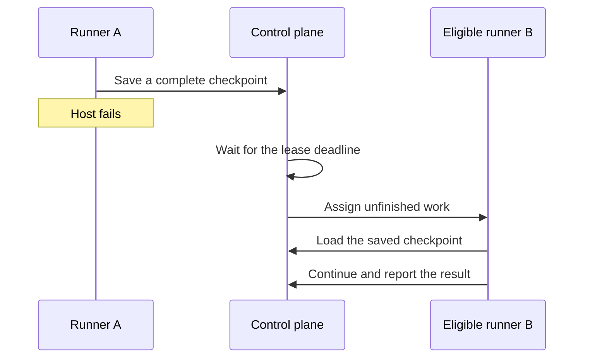

<Note>This feature is coming soon.</Note>

## What it is

An eligible platform runner can resume unfinished work from its last complete checkpoint after the previous runner fails.
You do not issue a checkpoint command.

The control plane saves ordinary API-only runs in encrypted PostgreSQL rows.
Durable tasks and checkpoints with workspace files also require the configured private object store.
Recovery keeps the saved conversation, accepted answers, local memory changes, and matching workspace files.

## Why it exists

A failed host can lose its local files and running processes.
Checkpoints keep completed progress outside that host so another eligible runner can continue the run.

## How it behaves

### Saving progress

The runner saves at a safe boundary before a continuing model call.
Running children, open sessions, active file work, or tenant processes prevent that boundary from being saved.

When the runner is busy transferring checkpoints, it can skip a file checkpoint and keep the last complete one.
An incomplete upload never replaces the last complete checkpoint.

### Replacing a failed runner

The failed runner's lease must expire before another runner takes the work.
The normal deadline is 35 seconds after the last confirmed renewal.
The deployment can configure the lease lifetime.

Capacity, permissions, funds, approval checks, and restore time can delay continuation.

With several interrupted runs, eligible runners can take work in parallel as workers become available.
A replacement runner keeps its lease active while waiting for file transfer capacity.
It restores the saved files before its next model or tool action.

### Controlling checkpoint resumption

The daemon deployment selects a Tom's Obvious Minimal Language (TOML) configuration file with
`AGENTSFLEET_CONFIG_FILE` or `agentsfleetd --config <FILE> serve`.

```toml
[runner.recovery]
resume_from_checkpoint = false
```

With this setting disabled, an interrupted ordinary run with a complete checkpoint
waits after its lease expires.
Saving new checkpoints continues.

Set the value to `true` and roll out the configuration to allow an eligible runner
to reclaim that admission and restore its saved progress.
Confirm the value on every daemon replica after the rollout completes.

Runs already holding a valid lease can continue.
Ordinary runs without a complete checkpoint and durable task recovery keep their
existing retry behavior.

### Retry limits

An ordinary event can receive at most three leases.
If all three lapse without a final report, its next claim ends it with an error.

Durable tasks default to twelve leases across the task.
Recovery uses that existing allowance; once it is exhausted, continuation stops.



A run without a completed checkpoint starts again from its original input and unsettled messages.
A changed setup, unreadable checkpoint, or missing file stops recovery before the model or tools start.

The chat shows **Run restarted** when it receives a restart notice or sees an attempt newer than the one already displayed.
Opening a stream halfway through an attempt does not itself add that notice.
The new attempt replaces the provisional reply; the final saved reply remains authoritative.

### Reading quarantine status

After 105 seconds without heartbeats, a background sweep marks the runner offline and adds automatic quarantine.
This quarantine stops new assignments while preserving the separate operator status.
Thirty seconds of continuous valid, healthy heartbeats clears automatic quarantine.

A heartbeat gap of 20 seconds or a degraded heartbeat resets the return check.
Clearing automatic quarantine preserves an operator's cordon, drain, or revocation.

Use credentials with `runner:read` permission.
Copy `<RUNNER_ID>` from `agentsfleet platform runners list`.
Install `jq` for this filtered JSON example.

```bash
agentsfleet platform runners show <RUNNER_ID> --json | jq '{id, status, liveness, cordon}'
```

For an automatically quarantined host, the output resembles:

```text
{
  "id": "<varies>",
  "status": "active",
  "liveness": "offline",
  "cordon": {
    "reason": "missed_heartbeats",
    "cordoned_at": "<varies>"
  }
}
```

The runner response omits `cordon` when automatic quarantine is absent.
The filter above then shows `"cordon": null`.

- `agentsfleet platform runners list` shows connection state and automatic quarantine across hosts.
- `agentsfleet platform runners events <RUNNER_ID>` shows cordon and return events.
- `agentsfleet platform runners leases <RUNNER_ID>` shows the host's work history.

## Limits

Work after the last complete checkpoint can repeat, including external actions.
Make those actions safe to repeat.
Checkpoints do not restore process memory or files outside the recovery workspace.

Workspace recovery requires a snapshot-capable Linux sandbox and configured private file storage.
A workspace still being built cannot publish a history-only checkpoint.

Upgrade the server, runners, dashboard, and command-line interface (CLI) together.
Finish running tasks before upgrading; older task checkpoint formats cannot resume under this release.

## Related pages

- [Runner policy and states](/runners)
- [Install a runner](/runners/install)
